<p align="center">
  
</p>

<h1 align="center">AmlouBot</h1>

<p align="center">
  <strong>A mobile robotics prototype combining wireless driving, a servo-controlled robotic hand, environmental sensing, GPS telemetry, and a live web control center.</strong>
</p>

<div align="center">


</div>

---

<h2 align="center">Showcase</h2>

<p align="center">
  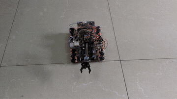
</p>

<p align="center"><sub><em>Large animated GIF, may take a moment to load.</em></sub></p>

> *AmlouBot is a completed mobile robotic platform built from scratch. One Wi-Fi access point, one ESP32-S3, 12 hardware peripherals, and a purpose-built web interface. No frameworks, no cloud, no vendor lock-in. Every subsystem is implemented, tested, and integrated.*

---

## What AmlouBot Does

AmlouBot is a **single-operator mobile robot** controlled entirely from a browser. Three traditionally separate subsystems (mobility, manipulation, and environmental sensing) run on one microcontroller, share one protocol, and are driven from one screen.

<table>
<tr>
<td width="50%" valign="top">

### Mobility
- 4-wheel differential drive
- Dual H-bridge motor control
- 8 directional commands + 2 rotations
- **1.5-second safety watchdog** with auto-stop on signal loss

</td>
<td width="50%" valign="top">

### Manipulation
- 4-DOF arm: **base, shoulder, grip, wrist**
- 14-bit LEDC PWM per servo (0 to 180 degrees)
- Realtime slider control from the browser
- 1-click **Home** pose

</td>
</tr>
<tr>
<td width="50%" valign="top">

### Sensing
- Temperature + humidity + dew point
- Barometric pressure + altitude
- **Time-of-Flight distance**
- Bus voltage / current / power
- **Ambient light (lux) + UV index**
- GPS: position, altitude, speed, course, satellites

</td>
<td width="50%" valign="top">

### Environmental Scan
- Automated **180-degree ToF sweep** on the arm's base servo
- Point-per-angle distance map (up to 181 samples)
- **Live radar visualization** rendered on HTML5 Canvas

</td>
</tr>
<tr>
<td width="50%" valign="top">

### Smart Lighting
- Dual front LEDs, individually addressable
- **Autonomous mode**: lights activate when ambient lux drops below threshold
- Blink / alternate animations
- Manual override always wins

</td>
<td width="50%" valign="top">

### Custom Control Deck
- **7 purpose-built panels**: Drive, Arm, Lights, Sensors, GPS, Light, Scan
- Hand-crafted **light + dark** themes
- Dual input: **D-Pad** *and* **analog joystick**
- Keyboard control: `WASD` / arrows / `Q` `E` / `Space`

</td>
</tr>
</table>

---

## System Architecture

AmlouBot is a **three-tier system**: a browser, a bridge server, and the robot. Communication is a purpose built newline delimited protocol **over raw TCP.** No MQTT broker, no WebSocket server, no HTTP between **the robot** and **the world.**

[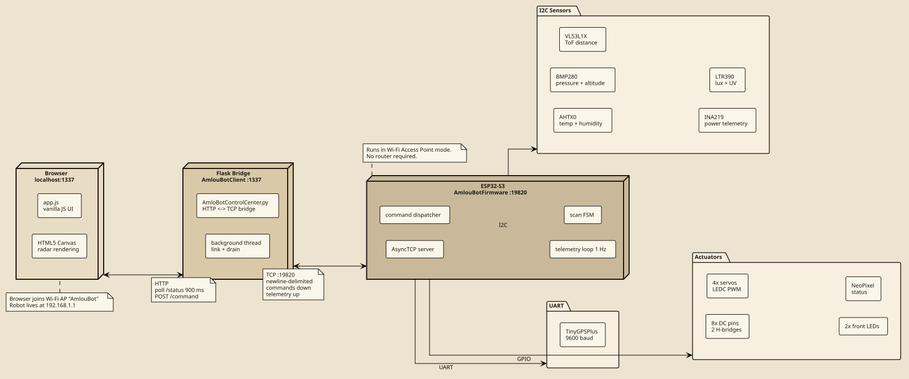](./docs/diagrams/amloubot-architecture.svg)


**Key engineering decisions:**

| Decision | Rationale |
|---|---|
| **ESP32 as AP, not STA** | Zero-configuration operation: no router, no mDNS, no credentials to flash. The robot is its own network. |
| **Raw TCP, not HTTP, to the robot** | Binary-safe, one-line commands, sub-millisecond latency, minimal flash cost. |
| **Flask as a bridge** | Decouples the protocol from the presentation, so future clients (mobile, desktop) can hit the same REST API without touching the robot. |
| **Background TCP thread + HTTP polling** | Simpler than WebSockets for a single-operator use case, and no `flask-socketio` complexity. |
| **Command heartbeat from client** | Client resends held commands every 350 ms; firmware watchdog stops motors after 1.5 s of silence. |

---

## Hardware

### Bill of Materials

| Category | Component | Qty | Bus / Pin | Purpose |
|---|---|---:|---|---|
| **MCU** | ESP32-S3-DevKitC-1 | 1 | (none) | Main controller |
| **Chassis** | Double-deck RC car plastic case | 1 | (none) | Robot body and motor mount |
| **Arm** | 4-DOF black plastic arm case | 1 | (none) | Robotic arm frame |
| **Motors** | DC gear motors + 2x H-bridge | 4 | GPIO 4 to 13 | Differential drive |
| **Servos** | Hobby servos | 4 | LEDC on GPIO 1, 2, 41, 42 | Robotic arm |
| **Light** | Front LEDs (white) | 2 | GPIO 21, 40 | Headlights |
| **Env** | AHTX0 (temp + humidity) | 1 | I2C 0x38 | Climate |
| **Env** | BMP280 (pressure) | 1 | I2C 0x77 | Altitude |
| **Range** | VL53L1X (ToF) | 1 | I2C 0x29 | Distance + scan |
| **Power** | INA219 (I/V/P) | 1 | I2C 0x40 | Battery telemetry |
| **Light** | LTR390 (ALS + UV) | 1 | I2C 0x53 | Auto-light + UVI |
| **GPS** | NEO-series + TinyGPSPlus | 1 | UART 17/18 @ 9600 | Position |


### Physical Build

<div align="center">

<table>
<td align="center" valign="top" width="50%">
<strong>Up view</strong><br>
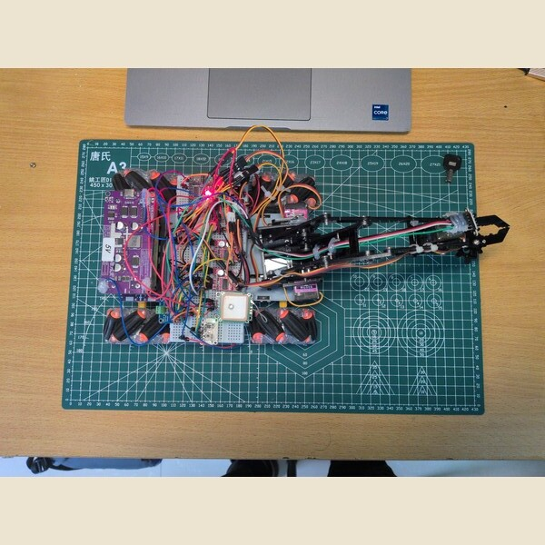<br>
</td>
</table>

<table>
<td align="center" valign="top" width="50%">
<strong>Right view</strong><br>
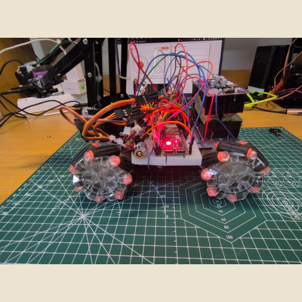<br>
</td>
<td align="center" valign="top" width="50%">
<strong>Left view</strong><br>
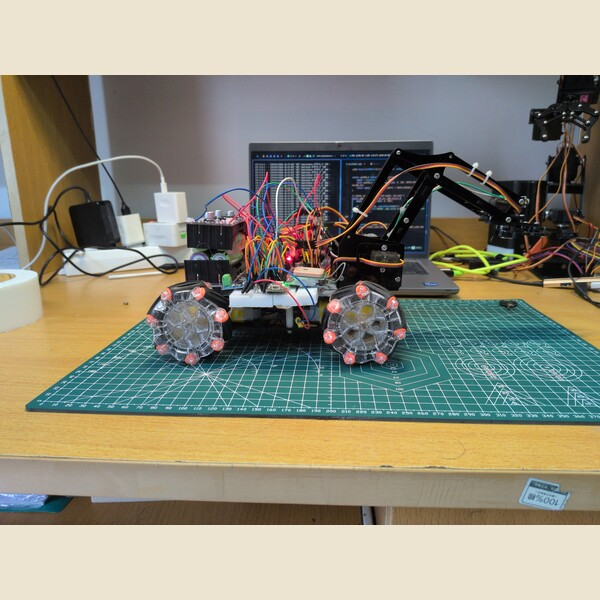<br>
</td>
<tr>
<td align="center" valign="top" width="50%">
<strong>Back view</strong><br>
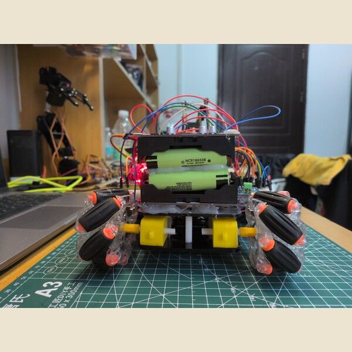<br>
</td>
<td align="center" valign="top" width="50%">
<strong>Front view</strong><br>
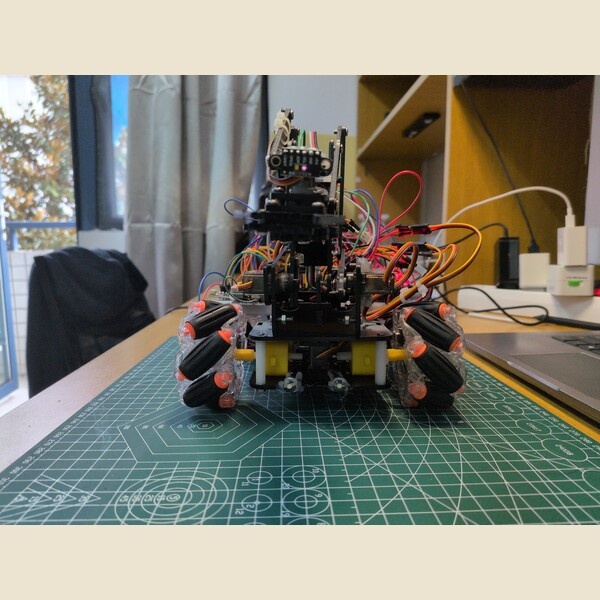<br>
</td>
</tr>
</table>
</div>


---

## Firmware Behaviour

The ESP32 runs a **non-blocking loop** with two asynchronous activities: the TCP server (event-driven, `AsyncTCP`) and the main loop (1 Hz telemetry + 10 ms tick). A small **state machine** governs what the robot is allowed to do at any moment.

<div align="center">

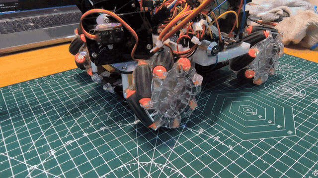

<sub><em>Animated GIF, may take a moment to load.</em></sub>

*Boot sequence: sensor probe, NeoPixel flash, three front-LED blinks, servos home to 105, 180, 110, 60.*


</div>

[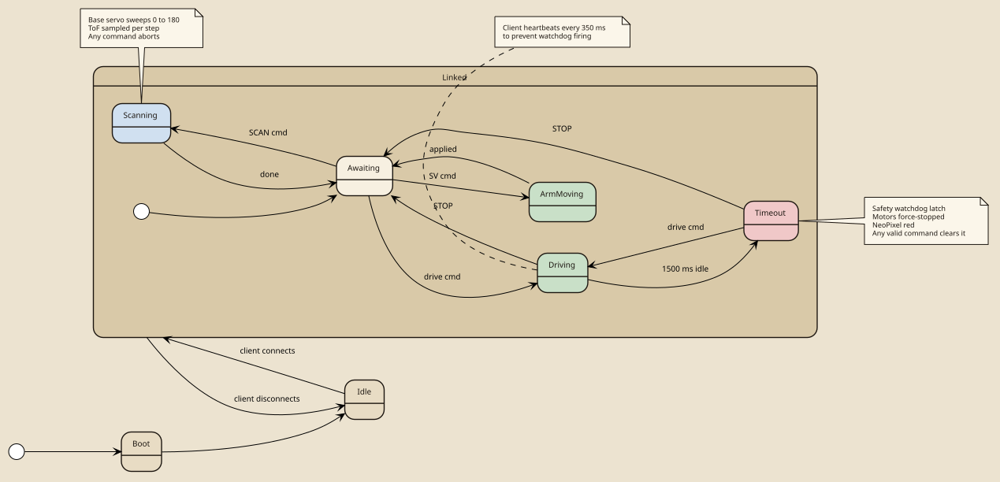](./docs/diagrams/firmware-behaviour.svg)


### Firmware highlights

- **Watchdog latch**: once triggered, motors stay stopped until a fresh command arrives. Prevents runaway on packet loss.
- **Scan preemption**: any command other than `SCAN` aborts an ongoing scan (`SCAN,STOP` is explicit; disconnect also aborts).
- **Sensor fault tolerance**: every I2C device is probed at boot and reported over serial; missing sensors simply produce `null` telemetry fields instead of crashing the loop.
- **Dual-mode light sensor**: the LTR390 alternates between **ALS** (lux) and **UVS** (UV index) each telemetry cycle to expose both metrics without extra hardware.
- **Telemetry batching**: one JSON line per second, capped at 450 bytes; runs off the main loop without blocking TCP.

---

## Communication Protocol

Two layers of protocol: **newline-delimited commands** (browser to robot) and **newline-delimited JSON telemetry** (robot to browser). Both are human-readable, so the robot can be driven with a raw `netcat` session.

### Command Flow (browser to robot)

<div align="center">

[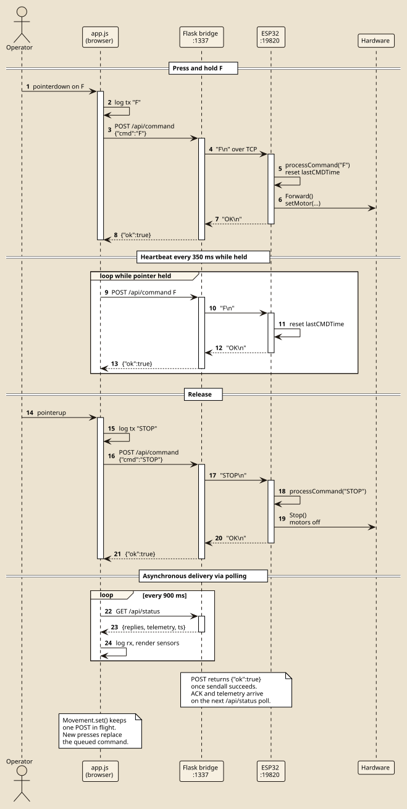](./docs/diagrams/sequence-command.svg)

<sub><em>Vector diagram, may take a moment to load.</em></sub>

</div>

### Command Reference

| Family | Command | Example | Notes |
|---|---|---|---|
| **Drive** | `F` `B` `L` `R` | `F` | Forward / Back / Left / Right |
| | `FL` `FR` `BL` `BR` | `FL` | Diagonal |
| | `RR` `RL` | `RR` | Rotate Right |
| | `STOP` | `STOP` | Stop all motors |
| **Arm** | `SV<a>,<b>,<c>,<d>` | `SV105,180,110,60` | base, shoulder, grip, wrist (each 0 to 180 degrees) |
| **Lights** | `LED,ON` `LED,OFF` | `LED,ON` | Both front LEDs |
| | `LED,BLINK` `LED,ALT` | `LED,BLINK` | Animation |
| | `AUTO,ON` `AUTO,OFF` | `AUTO,ON` | Autonomous mode (lux-driven) |
| **Scan** | `SCAN` | `SCAN` | Full 180-degree sweep, default step = 2 degrees |
| | `SCAN,<n>` | `SCAN,5` | Step size 1 to 45 degrees |
| | `SCAN,STOP` | `SCAN,STOP` | Abort immediately |

### Telemetry Stream (robot to browser)

```json
{
  "ms": 128431,
  "t": 24.31, "h": 41.10, "dp": 10.55,
  "p": 1017.02, "alt": 42.31, "dist": 318.00,
  "bv": 7.82, "sv": 2.10, "lv": 7.822, "c": 145.30, "pw": 1136.20,
  "lat": 33.573110, "lon": -7.589843,
  "galt": 47.20, "hdop": 0.92, "spd": 0.31, "crs": 214.50,
  "sats": 9, "gfix": 1,
  "lux": 212.30, "uvi": 0.42, "als": 5620, "uvs": 12,
  "dark": 0, "auto": 1
}
```


### Scan Stream (robot to browser, during a scan only)

```json
{"scan":1,"i":0,  "n":91, "ang":0,  "d":1240.00,"sig":3.21,"st":0}
{"scan":1,"i":1,  "n":91, "ang":2,  "d":1235.00,"sig":3.19,"st":0}
...
{"scan":1,"i":90, "n":91, "ang":180,"d":1890.00,"sig":2.87,"st":0}
{"scan":1,"done":1,"n":91}
```

---

## The Environmental Scan


<div align="center">
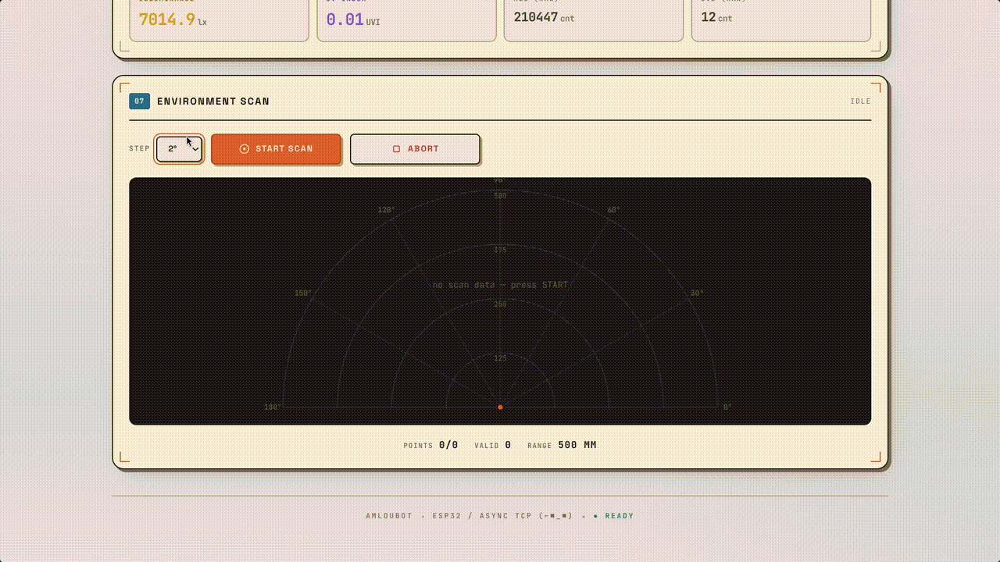
</div>

<p align="center"><sub><em>Animated GIF, may take a moment to load.</em></sub></p>

The scan is the flagship feature of AmlouBot. It converts a single ToF sensor into a **2D slice of the room** by sweeping the arm's base servo across 180 degrees and sampling distance at every step. The web client renders the result live as a radar.

<div align="center">

[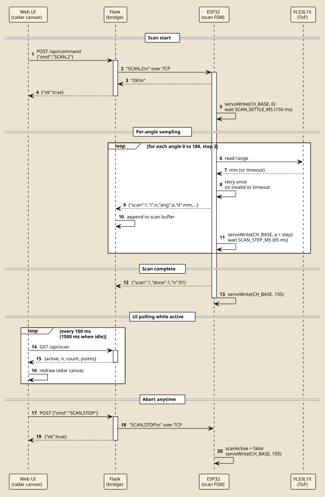](./docs/diagrams/sequence-scan.svg)

<sub><em>Vector diagram, may take a moment to load.</em></sub>

</div>

---

## The Control Deck

A single web page hosts all seven control panels. It drives the robot, moves the arm, toggles the lights, and displays live telemetry from every onboard sensor.

<div align="center">


| Light theme | Dark theme |
|:---:|:---:|
| 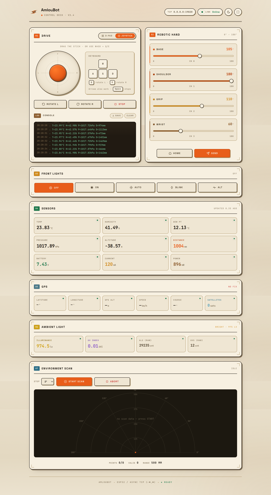 | 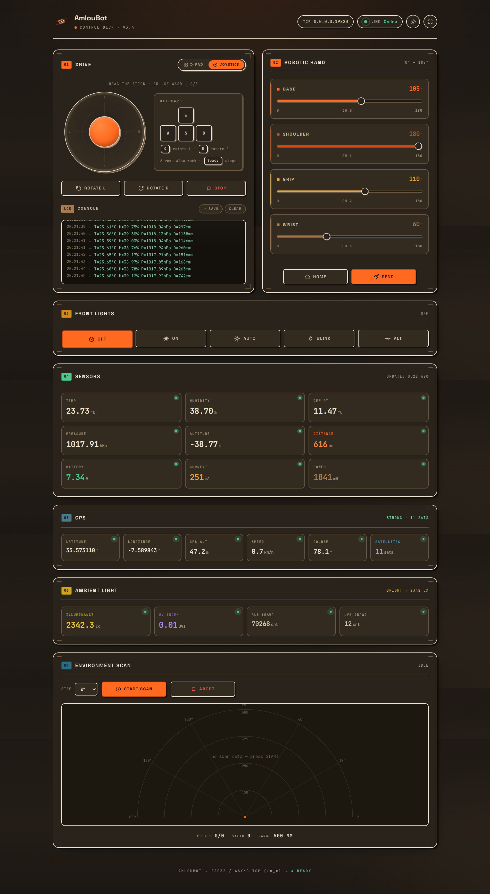 |


</div>

<p align="center"><sub><em>Screenshots, may take a moment to load.</em></sub></p>

### Panels

| # | Panel | What it does |
|---:|---|---|
| 01 | **Drive** | D-Pad and analog joystick, hold-to-move, keyboard (WASD, Q/E rotate, Space stop), live console |
| 02 | **Robotic Hand** | 4 sliders mapped to `SV` command, 60 ms debounce, per-channel accent color |
| 03 | **Front Lights** | On / Off / **Auto** / Blink / Alt, state synced from telemetry |
| 04 | **Sensors** | 9 cells: temp, humidity, dew point, pressure, altitude, distance, battery, current, power |
| 05 | **GPS** | Lat, Lon, GPS alt, speed, course, sats, **fix quality badge** |
| 06 | **Ambient Light** | Lux, UV index, raw ALS, raw UVS, **dark / dim / bright / sunny** badge |
| 07 | **Environment Scan** | Step selector, Start / Abort, live radar canvas, point/valid/max stats |

---

## Tech Stack

<table>
<tr>
<td valign="top" width="33%">

**Firmware**
- ESP32-S3
- Arduino framework
- PlatformIO
- AsyncTCP
- Adafruit sensor libraries
- TinyGPSPlus
- Hardware PWM for servos

</td>
<td valign="top" width="33%">

**Backend**
- Python 3.11+
- Flask
- Socket and threading
- uv package manager

</td>
<td valign="top" width="34%">

**Frontend**
- Vanilla JavaScript
- CSS
- HTML5 Canvas
- Light and dark themes

</td>
</tr>
</table>

---

## Repository Layout
```.
├── AmlouBotClient
│   ├── AmloBotControlCenter.py
│   ├── pyproject.toml
│   ├── static
│   │   ├── css
│   │   │   └── style.css
│   │   ├── icons
│   │   │   └── icon.png
│   │   └── js
│   │       └── app.js
│   ├── templates
│   │   └── index.html
│   └── uv.lock
│
├── AmlouBotFirmware
│   ├── include
│   ├── lib
│   ├── platformio.ini
│   └── src
│       └── main.cpp
│
├── docs
│   ├── diagrams
│   │   ├── amloubot-architecture.puml
│   │   ├── amloubot-architecture.svg
│   │   ├── firmware-behaviour.puml
│   │   ├── firmware-behaviour.svg
│   │   ├── sequence-command.puml
│   │   ├── sequence-command.svg
│   │   ├── sequence-scan.puml
│   │   └── sequence-scan.svg
│   └── media
│
├── README.md
```


---

## Running AmlouBot


### 1. Flash the firmware

```bash
cd AmlouBotFirmware
pio run --target upload && pio device monitor --baud 115200
```

The ESP32-S3 boots directly into Access-Point mode.

### 2. Join the Wi-Fi network

**SSID:** `AmlouBot` <br> **Password:** `Worisami1337`

### 3. Start the control deck

```bash
cd AmlouBotClient
uv run AmloBotControlCenter.py
```

Open **`http://localhost:1337`** and drive.

---

## Feature Completeness

AmlouBot ships with every planned feature integrated and verified.

| Subsystem | Status | Evidence |
|---|:---:|---|
| Differential drive + 8 directions + 2 rotations | Done | `processCommand()` in firmware, Drive panel |
| Safety watchdog (1.5 s auto-stop) | Done | `wdActive` latch in firmware `loop()` |
| 4-DOF arm with debounced slider control | Done | `SV` command, Robotic Hand panel |
| Environmental telemetry at 1 Hz | Done | `sendTelemetry()`, Sensors / GPS / Light panels |
| Autonomous light mode (lux threshold) | Done | `AUTO,ON`, `autoLightEnabled` in firmware |
| 180-degree ToF environmental scan with live radar | Done | `SCAN` command, `initScan()` in app.js |
| Dual-theme UI (light / dark) | Done | `html[data-theme]` CSS, theme toggle in header |
| Dual input (D-Pad + analog joystick) | Done | `bindMoveButton` + `bindJoystick` in app.js |
| Keyboard control (WASD / arrows / Q / E / Space) | Done | `Keyboard` module in app.js |
| Command console with log export | Done | `log()` + `downloadLog()` in app.js |
| GPS fix quality + stale-telemetry indicators | Done | `applyTelemetry()` in app.js |


---

## License

Released under the **MIT License**.

---

<div align="center">

**AmlouBot - 2026**

*One ESP32. Twelve peripherals. Zero cloud dependencies.*
</div>
